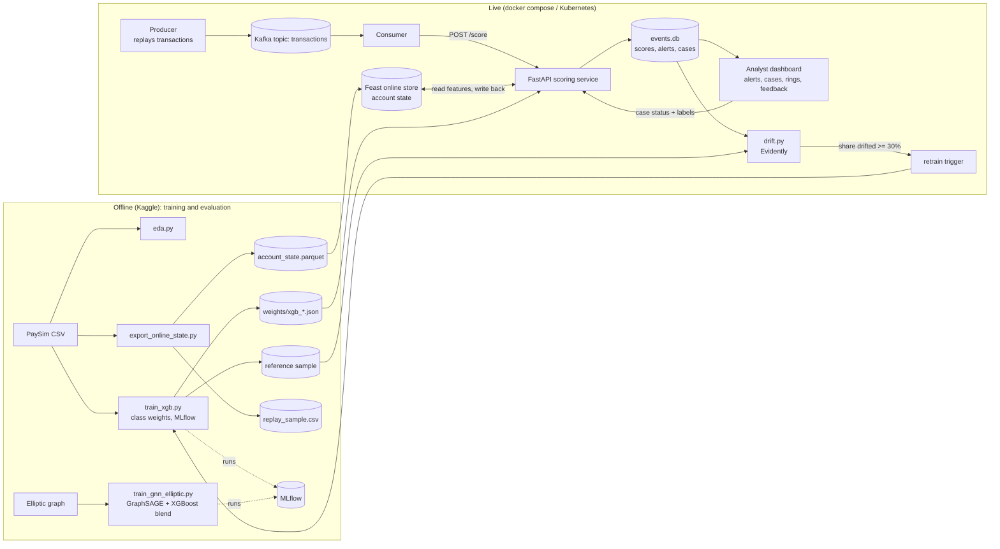

# Architecture

## Services
| Service | Tech | Job |
|---|---|---|
| Producer | confluent-kafka | Replays PaySim transactions, in arrival order, at a set rate |
| Kafka | `apache/kafka` (KRaft, one partition) | Transaction stream. One partition keeps order, which the per-account state needs |
| Consumer | confluent-kafka + requests | Calls `POST /score` per message, retries on API errors, skips malformed messages |
| Scoring API | FastAPI + XGBoost | Reads account features from Feast, builds the model input, scores, explains the top 3 drivers, writes the account state back, logs the event |
| Feast | SQLite online store | Per-account running state: count, amount sum, recent timestamps, as origin and as destination |
| Dashboard | Streamlit | Alert queue, case status, analyst verdicts (feedback labels), linked rings, latency and counts |
| Evidently | `monitoring/drift.py` | Compares recent scored traffic to the training reference, writes an HTML report, flags retraining |
| MLflow | SQLite backend | Parameters, metrics and model files of every training run |

## One transaction, end to end
1. The producer publishes it to Kafka; the consumer reads it and calls `/score`.
2. The API fetches the origin and destination account state from Feast and builds the 17 features with `fraud/features.py`.
3. XGBoost returns a fraud probability. At or above the threshold (chosen on validation data, not test) the decision is `alert`.
4. The API updates both accounts' state in Feast, so the next transaction sees it, and logs the event with its top reasons.
5. An analyst opens the alert in the dashboard, sets a status and a fraud/legitimate verdict. Verdicts are exported at `/feedback` for the next retraining run.

## Feature consistency (the Feast requirement)
Training computes features in bulk with vectorised pandas; serving computes them one transaction at a time from Feast state. Both use the definitions in `fraud/features.py`. `tests/test_features_parity.py` replays a stream through the online path and checks that it matches the bulk features exactly. We did not use `get_historical_features` for training because a point-in-time join over 2.7M rows is impractical on free compute; the parity test is what guarantees identical features.

## Fraud rings
- **Live:** alerts that share any account (origin or destination) are linked into one ring with union-find (`fraud/rings.py`, dashboard tab).
- **Graph model:** GraphSAGE on the Elliptic transaction graph, blended with XGBoost, plus connected components among flagged transactions. It is evaluated offline and is not part of the live scoring path (see LIMITATIONS).

## Retraining trigger
`monitoring/drift.py` computes the share of features Evidently flags as drifted. At or above `--threshold` (default 0.3) it writes `reports/retrain_requested.flag`; with `--run-retrain` it also runs `training/train_xgb.py`.
