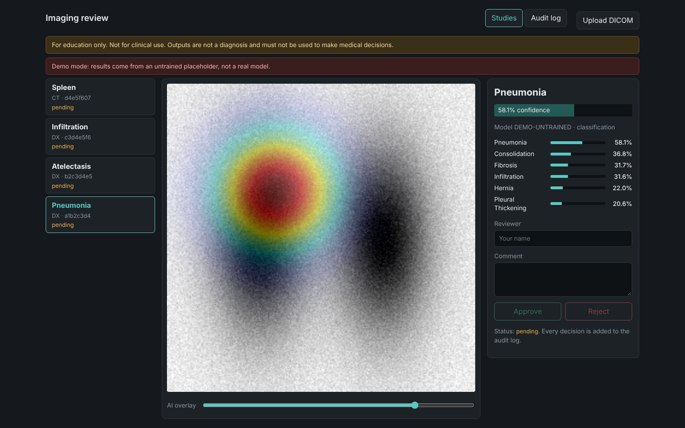
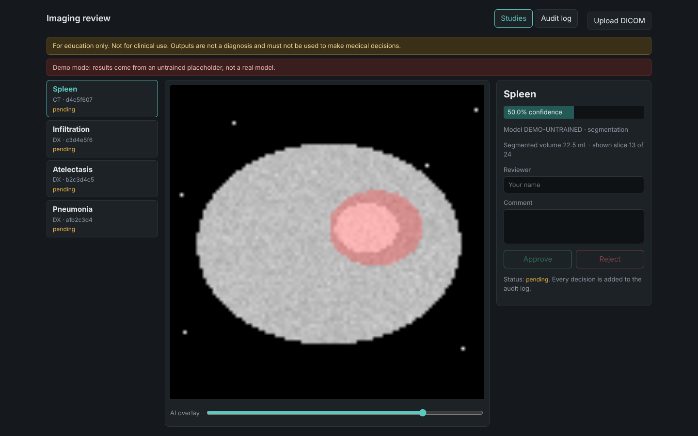
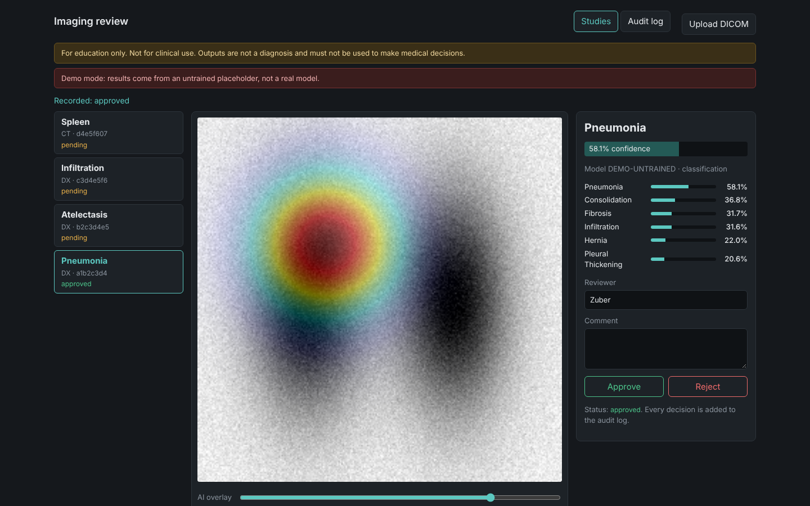
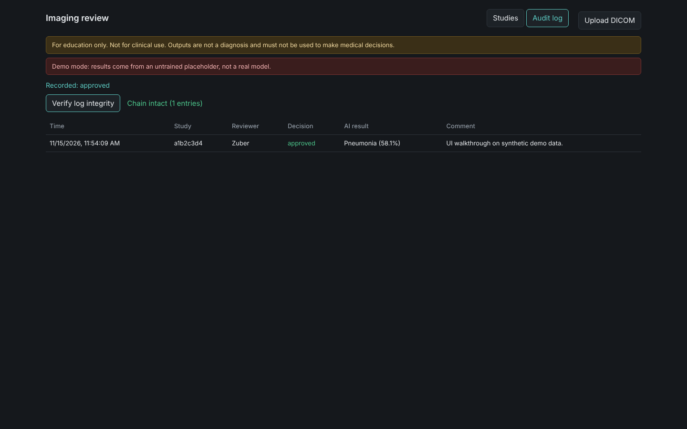

# AIML-02: AI-Assisted Medical Imaging and Diagnosis System

> **For education only. Not for clinical use.** See [docs/LIMITATIONS.md](docs/LIMITATIONS.md).

A platform where chest X-ray and CT studies arrive in a DICOM server, are analysed by deep learning models, shown
with explanation heatmaps, and reviewed by a radiologist who approves or rejects each result. Every decision goes
into a tamper-evident audit log.

| Task | Model | Data | Explanation |
|---|---|---|---|
| Chest X-ray classification (14 findings, multi-label) | DenseNet121, ImageNet transfer learning (PyTorch) | NIH ChestX-ray14 | Grad-CAM heatmap |
| CT spleen segmentation | 3D U-Net (MONAI) | Medical Segmentation Decathlon, Task09 Spleen | Mask overlay |

## Features
- **DICOM ingestion** with an Orthanc server. A poller reacts to `StableStudy` events, so studies are processed automatically and exactly once (sequence number persisted).
- **Routing by modality**: CT series go to the segmenter, other images to the classifier.
- **Grad-CAM** on the top predicted finding, blended over the original image.
- **React viewer**: scan, adjustable AI overlay, confidence bar, ranked findings, Approve/Reject with comment, DICOM upload.
- **Audit log**: append-only, each entry stores a SHA-256 chain hash. `GET /audit/verify` detects edits or deletions.
- **Reproducible data/training** with DVC (`dvc.yaml`), patient-level splits to prevent leakage, fixed seeds.
- **Docker Compose** for Orthanc, backend and frontend. A permanent "education only" banner is shown in the UI and API docs.

## Architecture
See [docs/ARCHITECTURE.md](docs/ARCHITECTURE.md) for the diagram and data flow, and [docs/API.md](docs/API.md) for endpoints.

```
ml/          training scripts (classifier, segmentation, NIH label prep)
backend/     FastAPI app, Orthanc poller, inference engine, Grad-CAM, audit log, tests
frontend/    React (Vite) review viewer
orthanc/     Orthanc configuration
weights/     trained weights (classifier.pt, labels.json, segmentation.pt)
reports/     metrics produced by training (JSON + markdown tables)
docs/        architecture, API, limits and bias
dvc.yaml     data -> training pipeline
```

## Quick start (run the app)

Requirements: Docker with Compose. The weights must exist in `weights/` (see Training), or use demo mode.

```bash
docker compose up --build
```
- Viewer: http://localhost:3000
- API docs: http://localhost:8000/docs
- Orthanc: http://localhost:8042 (DICOM port 4242)

Load studies by dragging DICOM files into **Upload DICOM** in the viewer, or send them to Orthanc with any DICOM
tool (`storescu`, Orthanc Explorer). They appear in the list about 5-10 seconds later.

**Pipeline smoke test without real data or weights** (placeholder outputs, clearly flagged in the UI):
```bash
DEMO_MODE=true docker compose up --build
cd backend && pip install -r requirements.txt && python -m app.sample --orthanc http://localhost:8042 --xray 2 --ct 1
```
Demo mode uses an untrained stub and synthetic images. It exists to test the plumbing. Do not quote its output as results.

## Training

Training needs a GPU. Kaggle or Colab free GPUs are enough. Upload the repo, then:

```bash
pip install -r ml/requirements.txt
# 1) Data: download NIH ChestX-ray14 (Data_Entry_2017.csv + images) into data/raw/nih
python ml/prepare_nih.py --data-entry data/raw/nih/Data_Entry_2017.csv --img-root data/raw/nih \
       --out data/processed/nih_labels.csv --max-images 20000
# 2) Classifier -> weights/classifier.pt, weights/labels.json, reports/classifier_metrics.{json,md}
python ml/train_classifier.py --csv data/processed/nih_labels.csv --epochs 5
# 3) Segmentation (auto-downloads Task09_Spleen) -> weights/segmentation.pt, reports/segmentation_metrics.json
python ml/train_segmentation.py --data-dir data/raw/msd --epochs 100
```
Copy `weights/` and `reports/` back into the repo before running the app.

### DVC
```bash
dvc init
dvc add data/raw/nih data/raw/msd      # raw data versioned by DVC, not git
dvc repro                              # prepare_labels -> train_classifier -> train_segmentation
dvc metrics show
```

## Results

| Model | Split | Metric | Value |
|---|---|---|---|
| DenseNet121 (14 findings) | held-out test (patient-level) | mean AUC | 0.807|
| 3D U-Net (spleen) | validation (see note) | Dice | 0.868 best checkpoint (epoch 55); 0.848 at final epoch|

Per-class AUCs are in `reports/classifier_metrics.md`. The spleen set has only 41 labelled volumes, so the Dice
value is measured on the split that also selected the checkpoint and is optimistic (see limitations).

## Screenshots

> **These show the viewer and workflow only.** They were captured with `DEMO_MODE=true` on **synthetic** images: the model output and heatmaps are an untrained placeholder (the red banner in each image says so), not results from the trained model. The trained models' real metrics are in **Results** above.

| | |
|---|---|
|  | **1. Chest X-ray study.** Scan with adjustable AI overlay (Grad-CAM position), confidence bar, ranked findings, Approve/Reject. |
|  | **2. CT study.** Segmentation mask overlay on the slice with the largest mask, with volume in mL. |
|  | **3. Radiologist decision.** Reviewer name and comment, status updated to approved. Note the education-only notice. |
|  | **4. Audit log** with the hash-chain integrity check. |

## Tests
```bash
cd backend && pip install -r requirements.txt -r requirements-dev.txt && pytest -q
```
The 7 tests run in demo mode with synthetic DICOM and cover: X-ray classification and heatmap output, CT
segmentation, rejection of too-short CT series, the full review flow, input validation, path-traversal safety,
and audit-chain tamper detection. They check the plumbing, not model accuracy. Model accuracy comes from the
training reports above.

## Limits and bias
Summarised here, detailed in [docs/LIMITATIONS.md](docs/LIMITATIONS.md): noisy text-mined labels, single-institution
data, no external or subgroup validation, uncalibrated confidence, a very small spleen training set, no
authentication, and no clinical validation of any kind.

## Reflection and presentation
Individual reflections and the final presentation are submitted separately as required by the project brief.
