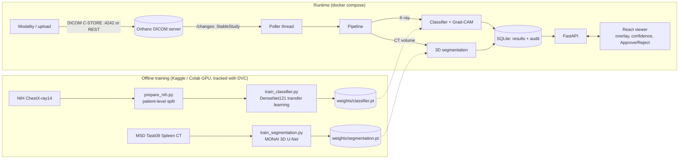

# Architecture

## Components
| Component | Tech | Responsibility |
|---|---|---|
| Orthanc | `jodogne/orthanc` | DICOM storage; emits a `StableStudy` change 5 s after the last instance arrives |
| Poller | Python thread | Reads Orthanc `/changes` from a persisted sequence number so nothing is processed twice or missed after a restart |
| Pipeline | pydicom, PyTorch, MONAI | Pulls the instances, routes by modality (CT -> segmentation, otherwise classification), writes preview + overlay PNGs and the result row |
| Classifier | DenseNet121, Grad-CAM | Multi-label sigmoid output over 14 findings; heatmap for the top finding |
| Segmenter | MONAI UNet (3D) | Sliding-window inference at 1.5x1.5x2.0 mm, HU window [-57, 164] |
| API | FastAPI | Studies, images, review, audit, upload |
| Viewer | React + Vite | Scan with adjustable AI overlay, confidence, Approve/Reject, audit log |
| Audit log | SQLite | Append-only. Each row stores `sha256(prev_hash + row)`. `GET /audit/verify` detects edits or deletions |

## Data flow for one study
1. DICOM arrives in Orthanc. After 5 s without new instances it is marked stable.
2. The poller sees `StableStudy` and calls `pipeline.process_study`.
3. Instances are downloaded and read with pydicom. A chest X-ray goes to the classifier. A CT series (at least 20 slices) goes to the segmenter.
4. Results, a preview PNG and an overlay PNG are stored. The study appears in the viewer as `pending`.
5. The radiologist approves or rejects. The decision (reviewer, comment, the AI label and confidence, model version) is written to the audit log.

## Preprocessing parity
The constants that must match between training and serving live in `backend/app/config.py`
(`IMG_SIZE`, `MEAN`, `STD`, `SEG_SPACING`, `SEG_HU`, `SEG_ROI`) and are repeated in the two training scripts.
Change them in all three places together.
